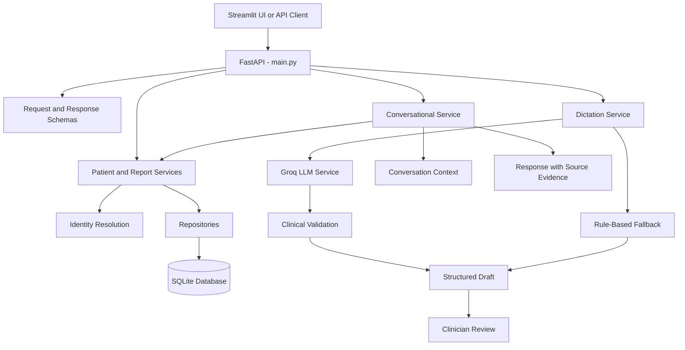

# Viscan Dental Assistant

**AI Engineer Take-Home Assignment | Voice-First Dental Assistant Prototype**

A proof of concept for patient report retrieval, clinical dictation-to-draft generation, and context-aware conversational follow-ups using synthetic data.

> **Important:** This project uses synthetic patient data only. It is an experimental prototype, not a clinically validated system. All generated clinical drafts require qualified clinician review.

## Table of Contents

- [Overview](#overview)
- [Problem Statement](#problem-statement)
- [Features](#features)
- [Technology Stack](#technology-stack)
- [Architecture](#architecture)
- [Project Structure](#project-structure)
- [Dataset](#dataset)
- [Requirements](#requirements)
- [Installation](#installation)
- [Environment Configuration](#environment-configuration)
- [Running the Application](#running-the-application)
- [API Reference](#api-reference)
- [Example Workflows](#example-workflows)
- [Testing](#testing)
- [Safety and Validation](#safety-and-validation)
- [Privacy and Production Considerations](#privacy-and-production-considerations)
- [Known Limitations](#known-limitations)
- [Future Improvements](#future-improvements)
- [Assignment Deliverables](#assignment-deliverables)
- [Disclaimer](#disclaimer)
- [Author](#author)

## Overview

Viscan Dental Assistant explores how AI can assist dental professionals with three common workflows:

1. **Patient report retrieval:** Retrieve the appropriate synthetic dental report while handling ambiguous patient identities and missing records safely.
2. **Clinical dictation:** Convert typed clinical observations or speech-to-text transcripts into structured JSON and a readable draft report.
3. **Context-aware conversation:** Support follow-up requests such as "Summarize her report" using previously established conversation context and source evidence.

The application uses FastAPI for backend APIs, SQLite for local data storage, SQLAlchemy for database access, Streamlit for the user interface, and Groq for LLM-assisted dictation interpretation.

The implementation separates API schemas, repositories, application services, and safety-related validation to keep the core workflows modular and testable.

## Problem Statement

Dental professionals may need to locate patient reports quickly, document observations accurately, and refer to information discussed earlier in a conversation.

A useful assistant should do more than generate fluent text. It should:

- Retrieve the correct report rather than silently choosing between patients with similar names.
- Preserve the original clinical observation and its uncertainty.
- Avoid introducing unsupported findings.
- Keep generated reports editable and subject to clinician review.
- Use the correct conversation context for follow-up questions.
- Provide evidence for report-related answers.

This prototype demonstrates these principles using a small synthetic dataset and a combination of LLM-assisted processing and deterministic application logic.

## Features

### 1. Patient Report Retrieval

- Retrieve synthetic dental reports through an API and interactive UI.
- Support patient names that may be similar.
- Handle ambiguous identity matches by requesting clarification.
- Handle missing patients and unavailable reports safely.
- Validate request inputs and return appropriate errors for invalid requests.
- Provide report information that can support subsequent conversational responses.

### 2. Clinical Dictation to Structured Draft

Accept a typed transcript and process it into a structured draft containing:

- Anatomical sites
- Stated findings
- Uncertain statements
- Unclassified statements
- A readable report draft
- Processing mode
- Clinician-review status
- Safety notes

The workflow aims to preserve source wording, retain negation, distinguish uncertainty, and avoid adding observations that were not present in the transcript.

LLM output is validated before being incorporated into the draft. A rule-based fallback is available when LLM processing fails or cannot be used successfully.

### 3. Groq LLM Integration

- Uses the Groq API for LLM-assisted dictation interpretation.
- Reads API credentials from environment variables.
- Supports configurable model selection.
- Requests structured output from the LLM.
- Checks output structure and verifies that extracted statements are grounded in the source transcript.
- Uses rule-based processing as a fallback when appropriate.

Textual grounding checks reduce some risks but do not establish clinical correctness.

### 4. Context-Aware Conversational Follow-Up

- Supports follow-up requests that refer to a previously selected patient or report.
- Uses available conversation context to resolve references when unambiguous.
- Provides report evidence for relevant answers.
- Avoids silently selecting a patient when identity is ambiguous.

Conversation context is maintained in memory in the current prototype. Persistence across server restarts and production-grade session isolation are not assumed.

### 5. Interactive User Interface

The Streamlit application provides an interface for exploring report retrieval, dictation, and conversation workflows without requiring users to manually construct API requests.

### 6. Automated Testing

The test suite covers implemented functionality such as retrieval, ambiguity handling, dictation processing, validation, and safety-related behaviour.

See the [Testing](#testing) section for the latest recorded test results.

## Technology Stack

| Technology | Purpose |
|---|---|
| Python | Application and service logic |
| FastAPI | Backend API |
| Pydantic | Request and response schema validation |
| SQLAlchemy | Database access and ORM |
| SQLite | Local storage for synthetic patients and reports |
| Groq API | LLM-assisted dictation interpretation |
| Streamlit | Interactive frontend |
| pytest | Automated testing |
| Uvicorn | ASGI server |
| python-dotenv | Environment variable loading |

## Architecture

The application follows a layered design that separates API handling, data access, business logic, and safety validation.



### Component Responsibilities

| Component | Responsibility |
|---|---|
| `app/main.py` | FastAPI application and API endpoints |
| `app/database.py` | Database configuration and connection management |
| `app/models.py` | SQLAlchemy database models |
| `app/seed_db.py` | Database seeding workflow |
| `app/repositories/` | Patient and report data access |
| `app/safety/identity_resolution.py` | Patient identity matching and ambiguity handling |
| `app/safety/clinical_validation.py` | Clinical output validation and safety checks |
| `app/schemas/` | API request and response schemas |
| `app/services/patient_service.py` | Patient-related application logic |
| `app/services/report_service.py` | Report retrieval workflow |
| `app/services/dictation_service.py` | Dictation processing and draft generation |
| `app/services/llm_service.py` | LLM interaction and structured extraction |
| `app/services/conversation_service.py` | Context-aware conversational workflow |
| `ui/streamlit_app.py` | Interactive user interface |
| `tests/` | Automated tests |

### Design Principles

- **Separation of concerns:** Repositories, services, schemas, and safety checks have distinct responsibilities.
- **Deterministic data access:** Patient and report retrieval uses application logic and database queries rather than relying on the LLM to invent or select records.
- **LLM output validation:** Model-generated statements are checked before they are used in a draft.
- **Safe identity resolution:** Ambiguous patient references should lead to clarification.
- **Graceful degradation:** Rule-based processing can provide a fallback when LLM processing fails.
- **Human oversight:** Generated clinical drafts are marked for clinician review.

## Project Structure

```text
viscan-dental-assistant/
├── app/
│   ├── repositories/
│   │   ├── patient_repository.py
│   │   └── report_repository.py
│   ├── safety/
│   │   ├── clinical_validation.py
│   │   └── identity_resolution.py
│   ├── schemas/
│   │   ├── conversation_schemas.py
│   │   ├── dictation_schemas.py
│   │   └── report_schemas.py
│   ├── services/
│   │   ├── conversation_service.py
│   │   ├── dictation_service.py
│   │   ├── llm_service.py
│   │   ├── patient_service.py
│   │   └── report_service.py
│   ├── database.py
│   ├── main.py
│   ├── models.py
│   └── seed_db.py
├── data/
│   └── seed_data.json
├── docs/
│   ├── demo.md
│   └── architecture.md
├── tests/
│   ├── test_api.py
│   ├── test_conversation.py
│   ├── test_database.py
│   ├── test_dictation.py
│   ├── test_patient_identity.py
│   ├── test_report_service.py
│   └── test_repositories.py
├── ui/
│   └── streamlit_app.py
├── .env.example
├── .gitignore
├── README.md
└── requirements.txt
```

## Dataset

The project includes a synthetic seed dataset at `data/seed_data.json`.

The dataset demonstrates:

- Multiple synthetic patient identities.
- Similar patient names for testing ambiguity handling.
- Multiple reports per patient.
- Report retrieval and context-aware follow-up workflows.

Only synthetic records should be used in the repository and demonstrations.

Initialize the database using the seeding procedure defined in `app/seed_db.py.`

Ensure the database is initialized successfully before testing patient report retrieval. 

## Requirements

- Python 3.11 recommended
- pip
- Git
- A Groq API key for LLM-assisted dictation
- Internet access for requests to the Groq API

A working Groq connection may not be necessary for report retrieval or supported rule-based workflows.

## Installation

### 1. Clone the Repository

```bash
git clone https://github.com/PrashantGupta77/viscan-dental-assistant.git
cd viscan-dental-assistant
```

### 2. Create a Virtual Environment

**Windows PowerShell**

```powershell
py -3.11 -m venv venv
.\venv\Scripts\Activate.ps1
```

If PowerShell blocks activation, consult your local execution-policy settings or invoke the virtual environment's Python executable directly.

**macOS / Linux**

```bash
python3.11 -m venv venv
source venv/bin/activate
```

### 3. Install Dependencies

```bash
python -m pip install --upgrade pip
python -m pip install -r requirements.txt
```

### 4. Configure Environment Variables

Copy `.env.example` to `.env`.

**Windows PowerShell**

```powershell
Copy-Item .env.example .env
```

**macOS / Linux**

```bash
cp .env.example .env
```

Edit `.env` and add your Groq API key.

### 5. Initialize the Database

From the project root directory, run the database initialization script:

```powershell
python app/seed_db.py
```

The script initializes the local database and loads the synthetic seed data according to the current implementation.

Ensure the command completes successfully before testing patient report retrieval.

## Environment Configuration

Example `.env.example`:

```dotenv
GROQ_API_KEY=your_groq_api_key_here
GROQ_MODEL=openai/gpt-oss-20b
```

- `GROQ_API_KEY`: API key used to authenticate with Groq.
- `GROQ_MODEL`: Model identifier used by the LLM service.

Use a model identifier supported by your Groq account and the current API.

**Security practices:**

- Never hardcode your API key in source code.
- Never commit `.env`.
- Keep placeholder values in `.env.example`.
- Never include secrets in screenshots, logs, or demo recordings.

## Running the Application

Start the backend and frontend in separate terminals.

### Terminal 1: Start the FastAPI Backend

From the project root, with the virtual environment activated:

```powershell
uvicorn app.main:app --reload
```

Expected local URLs, provided the corresponding routes are configured:

- API: http://127.0.0.1:8000
- Swagger UI: http://127.0.0.1:8000/docs
- ReDoc: http://127.0.0.1:8000/redoc
- Health check: http://127.0.0.1:8000/health

### Terminal 2: Start the Streamlit UI

```powershell
python -m streamlit run ui/streamlit_app.py
```

Open the URL printed by Streamlit, typically http://localhost:8501.

Use the interface to explore report retrieval, dictation drafting, and conversational follow-ups.

## API Reference

The application exposes the following main workflows.

| Method | Endpoint | Purpose |
|---|---|---|
| `GET` | `/health` | Check API health |
| `POST` | `/reports/retrieve` | Retrieve a synthetic patient report |
| `POST` | `/dictation/draft` | Generate a structured dictation draft |
| `POST` | `/conversation/message` | Process a conversational message using available context |

Use Swagger UI at http://127.0.0.1:8000/docs to inspect the implemented request and response schemas and execute requests interactively.

### 1. Health Check

```http
GET /health
```

Use this endpoint to confirm that the API is running.

### 2. Patient Report Retrieval

```http
POST /reports/retrieve
Content-Type: application/json
```

Illustrative request:

```json
{
  "patient_name": "Priya Sharma",
  "report_type": "OPG"
}
```

The actual request fields and accepted values are defined by the implemented Pydantic schema.

Expected behaviour:

- Return the matching report when patient identity and report selection are sufficiently specific.
- Request clarification when multiple patients match.
- Handle missing patients or reports without returning an unrelated patient's data.
- Reject invalid requests according to the API's validation rules.

### 3. Clinical Dictation Draft

```http
POST /dictation/draft
Content-Type: application/json
```

Illustrative request:

```json
{
  "dictation": "Tooth 36 shows no caries.",
  "use_llm": true
}
```

The actual request fields must match the schema shown in Swagger UI.

A representative response may contain:

```json
{
  "processing_mode": "groq",
  "anatomical_sites": [
    "Tooth 36"
  ],
  "stated_findings": [
    "Tooth 36 shows no caries."
  ],
  "uncertain_statements": [],
  "unclassified_statements": [],
  "report_text": "Anatomical site(s): Tooth 36\nStated findings: Tooth 36 shows no caries.",
  "requires_clinician_review": true,
  "safety_notes": [
    "This is an unverified draft, not a diagnosis.",
    "Original dictation must be reviewed before clinical use."
  ]
}
```

This response is illustrative. Actual fields, safety-note wording, and processing-mode values depend on the implementation.

When LLM processing is enabled and succeeds, the response should indicate the corresponding processing mode. If LLM processing fails or its output cannot be validated, the application may use rule-based fallback processing.

### 4. Conversational Follow-Up

```http
POST /conversation/message
Content-Type: application/json
```

To test the workflow:

1. Retrieve a report for a specific synthetic patient.
2. Continue within the same conversation context.
3. Ask: "Summarize her report."
4. Verify that the response refers to the intended report.
5. Inspect the returned source evidence.
6. Test an ambiguous initial identity and verify that the application requests clarification.

For the exact payload and response format, refer to Swagger UI.

## Example Workflows

### Workflow A: Retrieve a Patient Report

1. Start the backend and open the Streamlit UI.
2. Request a report for a synthetic patient.
3. Confirm that the patient and report are correct.
4. Search using a name shared by multiple synthetic patients.
5. Confirm that the system requests clarification.
6. Search for a nonexistent patient or unavailable report and inspect the response.

### Workflow B: Convert Dictation into a Draft

Test the following transcripts separately.

**Explicit finding**

```text
Tooth 36 shows caries.
```

**Uncertain observation**

```text
Possible periapical lesion near tooth 36.
```

**Negative observation**

```text
Tooth 36 shows no caries.
```

Review the following:

- Anatomical sites
- Stated findings
- Uncertain statements
- Unclassified statements
- Readable report draft
- Processing mode
- Clinician-review flag
- Safety notes

Verify that the generated draft does not introduce observations that are absent from the transcript.

### Workflow C: Context-Aware Conversation

1. Retrieve a synthetic patient's report.
2. Ask a follow-up question without repeating the patient's name.
3. Confirm that the intended report is used when the reference is unambiguous.
4. Verify that source evidence accompanies the answer.
5. Confirm that ambiguity is handled safely when the initial identity cannot be resolved.

## Testing

Run the automated tests from the project root.

### Full Test Suite

```powershell
python -m pytest -v
```

### Tests Directory Only

```powershell
python -m pytest tests -v
```

### Concise Output

```powershell
python -m pytest -q
```

### Show Additional Test Information

```powershell
python -m pytest -ra
```

### Test Results

The automated test suite was executed using:

```powershell
python -m pytest tests -v
```

**Latest recorded result: 49 passed, 0 failed.**

The test suite covers:

- Patient identity resolution and ambiguous-name handling
- Correct report retrieval and missing-report scenarios
- Context-aware conversations and follow-up questions
- Clinical dictation structuring and uncertainty handling
- Rejection of unsupported findings and rule-based fallback behaviour
- Input validation, database relationships, and source evidence

All 49 tests passed in the latest recorded run. These results demonstrate the tested behaviour of the current prototype; they do not establish clinical validity or production readiness.

### Important Regression Cases

The assignment requires automated coverage for at least:

1. Correct report retrieval.
2. Ambiguous patient identity.
3. Unsupported clinical claims.

Additional useful regression cases include:

- Missing patient or report.
- Invalid API inputs.
- Negation preservation.
- Uncertain observations.
- Malformed LLM output.
- LLM failure and rule-based fallback.
- Context-dependent follow-up and source evidence.

## Safety and Validation

### Patient Identity Resolution

Similar patient names can create a risk of retrieving the wrong report. The application should resolve identity using available matching information and request clarification when multiple candidates remain plausible.

### Clinical Output Validation

The dictation workflow separates LLM-assisted interpretation from application-level validation.

The application checks the generated structure and verifies whether extracted statements are grounded in the input transcript. These checks can detect some unsupported output, but source-text matching alone cannot establish that the clinical meaning is correct.

### Uncertainty and Negation

Clinical language may contain uncertainty, negation, and qualifiers. For example, "possible lesion" and "no caries" must not be transformed into unsupported definitive positive findings.

These cases should be tested explicitly and reviewed by a qualified clinician.

### Fallback Processing

When LLM processing fails or output validation fails, the service can use rule-based processing where supported. The returned processing mode should make the fallback visible to the user.

Rule-based processing is also limited and should not be treated as clinical verification.

### Clinician Review

Generated drafts are intended for review and editing. The application marks them as requiring clinician review before any hypothetical clinical use.

## Privacy and Production Considerations

### Privacy

- The included data is synthetic.
- Use synthetic records in demonstrations.
- Store API credentials in environment variables.
- Avoid writing sensitive information to application logs or exposing it in error messages.

### Authorization

The current prototype is intended for local demonstration. Before real deployment, it would need authentication, authorization, session isolation, and appropriate access controls.

### Latency and Cost

LLM requests introduce network latency and provider usage costs. Actual latency and cost depend on the selected model, input length, request volume, and provider pricing.

A production version should measure request latency, token usage, failures, and fallback frequency. Deterministic database retrieval should be kept separate from unnecessary LLM calls.

### Reliability

Production use would require structured error handling, monitoring, rate limiting, timeout management, and explicit handling of provider outages.

### Data Retention

Conversation context is held in application memory in the current prototype. It is not a production-grade persistence or multi-user session-management solution.

## Known Limitations

- **Synthetic data only:** The included records do not represent real patients.
- **Typed transcript input:** The current workflow accepts text. It does not implement a complete live microphone and speech-to-text pipeline.
- **LLM variability:** Output may vary with the selected model, prompt, provider behaviour, and configuration.
- **Limited grounding guarantees:** Matching output text to the source transcript does not prove correct clinical interpretation.
- **Rule-based fallback:** Complex clinical language and nuanced statements may not be classified correctly.
- **In-memory conversation state:** Context may be lost when the backend restarts.
- **Prototype-level security:** Production authentication and authorization are not assumed.
- **No clinical validation:** The system has not been validated for real-world diagnosis or treatment decisions.

## Future Improvements

Potential improvements include:

- Add speech-to-text integration while retaining a typed-transcript fallback.
- Strengthen schema validation and unsupported-claim regression tests.
- Improve handling of clinical abbreviations, uncertainty, and negation.
- Persist conversation context securely with explicit session boundaries.
- Add authentication, authorization, and audit logging.
- Measure end-to-end latency, provider errors, and model usage costs.
- Expand the synthetic dataset and evaluate retrieval ambiguity.
- Add a reproducible demo script and a documented set of API requests and outputs.

## Assignment Deliverables

| Requirement | Implementation or evidence |
|---|---|
| Patient report retrieval | Report retrieval API, services, repositories, and synthetic data |
| Ambiguous identity handling | Identity-resolution safety module |
| Clinical dictation | Dictation service and structured schemas |
| LLM integration | Groq-backed LLM service |
| Deterministic validation | Clinical validation and application-level checks |
| Contextual follow-up | Conversational service and report evidence |
| Synthetic dataset | `data/seed_data.json` |
| Automated testing | `tests/` |
| Setup documentation | `README.md` |
| Architecture explanation | Architecture section and `docs/architecture.md` |
| Demo evidence | `docs/demo.md` (documented workflow evidence) |


## Disclaimer

Viscan Dental Assistant is an experimental AI engineering proof of concept. It is not clinically validated and must not be used to diagnose patients, recommend treatment, or make clinical decisions.

All patient records and report examples included with the project are synthetic. Any generated clinical draft requires qualified clinician review before any hypothetical clinical use.

## Author

**Prashant Kumar Gupta**  
AI / ML Engineer