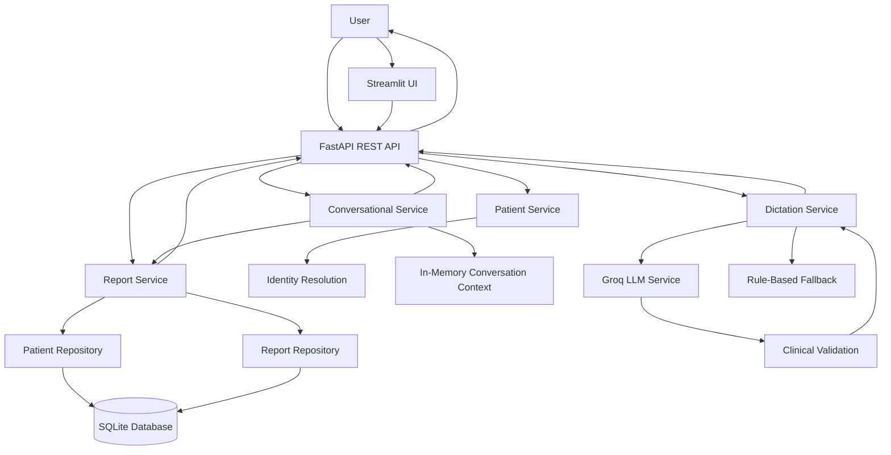

# System Architecture — Viscan Dental Assistant

## 1. Overview

Viscan Dental Assistant is a proof of concept for a voice-first dental assistant designed to support three core workflows:

1. **Patient report retrieval:** Retrieve the appropriate dental report while handling ambiguous identities and missing records safely.
2. **Clinical dictation structuring:** Transform a text-based clinical dictation transcript into a structured draft with anatomical sites, stated findings, uncertain statements, and a readable report.
3. **Context-aware follow-up:** Answer follow-up questions using previously selected report context and provide source evidence where available.

The prototype uses synthetic patient data and requires clinician review of all generated clinical drafts.

## 2. Architecture Diagram



## 3. Main Components

| Component | Responsibility |
|---|---|
| Streamlit UI (`ui/streamlit_app.py`) | Provides a lightweight interface for interacting with the assistant. |
| FastAPI application (`app/main.py`) | Exposes API endpoints and coordinates request handling. |
| Patient service and identity resolution | Resolves patient names, detects ambiguous matches, and avoids silently selecting the wrong patient. |
| Report service and repositories | Retrieve patient records and reports, including the latest report matching the requested type. |
| Conversational service | Handles contextual follow-up requests and uses the selected report when the reference is unambiguous. |
| Dictation service | Coordinates structured draft generation, validation, fallback behaviour, and clinician-review requirements. |
| Groq LLM service (`app/services/llm_service.py`) | Interprets dictation transcripts and produces structured candidate output. |
| Clinical validation (`app/safety/clinical_validation.py`) | Applies application-level checks intended to prevent unsupported findings from being accepted. |
| SQLite database | Stores synthetic patients and dental reports. |
| Automated tests (`tests/`) | Verify API behaviour, identity resolution, report retrieval, conversation context, dictation handling, and validation scenarios. |

## 4. Core Data Flow

### A. Patient Report Retrieval

1. The user submits a patient name and, optionally, a report type.
2. The API validates the request.
3. Patient identity resolution checks the available patient records.
4. If the identity is ambiguous, the application requests clarification rather than silently choosing a patient.
5. The report service retrieves the matching report through the repository layer.
6. The API returns the result and source evidence where available.

### B. Clinical Dictation Structuring

1. The user supplies a text dictation transcript.
2. The dictation service sends the transcript to the Groq-backed LLM service when LLM processing is enabled.
3. The LLM proposes structured anatomical sites, stated findings, uncertain statements, and unclassified statements.
4. Application-level validation checks the output against the original transcript.
5. If the LLM fails or produces unsupported output, the service can use the rule-based fallback.
6. The application returns a readable draft with an explicit clinician-review requirement.

The current implementation accepts text transcripts. Live microphone capture and speech-to-text transcription are not claimed as implemented components.

### C. Context-Aware Follow-Up

1. The user retrieves a report within a conversation.
2. The conversational service records the selected report in the conversation context.
3. A follow-up such as “Summarize her report” uses that context when the reference remains unambiguous.
4. The response refers to the selected source report where available.
5. A new conversation does not inherit the previous conversation's report context.

Conversation context is held in memory in the current prototype and may be lost when the backend restarts.

## 5. API Surface

| Endpoint | Purpose |
|---|---|
| `GET /health` | Check application health. |
| `POST /reports/retrieve` | Retrieve a patient's report. |
| `POST /dictation/draft` | Generate a structured clinical dictation draft. |
| `POST /conversation/message` | Process a conversational request or contextual follow-up. |

Interactive API documentation is available at `/docs` when the FastAPI server is running locally.

## 6. Safety and Validation

The prototype separates LLM interpretation from application-level validation and business rules.

- **Identity safety:** Ambiguous patient matches require clarification.
- **Input validation:** Invalid or unsupported request values are rejected.
- **Source grounding:** Dictation output is checked against the original transcript to detect unsupported wording.
- **Fallback behaviour:** LLM failures or rejected output can trigger rule-based processing.
- **Uncertainty handling:** Uncertain statements are represented separately rather than automatically treated as confirmed findings.
- **Human oversight:** Every generated draft requires clinician review.

Textual matching is not equivalent to semantic or clinical validation. These controls reduce some failure risks but do not guarantee clinical correctness.

## 7. Data, Privacy, and Deployment Considerations

The current proof of concept uses synthetic data stored in SQLite. It is intended for local demonstration and evaluation, not production clinical deployment.

A production implementation would require authentication, patient-level authorization, secure secret management, appropriate encryption, audit logging, persistent conversation storage, retention policies, and formal privacy and security reviews.

LLM use introduces external service dependency, latency, availability, and usage costs. API credentials must be supplied through environment variables and must never be committed to version control.

## 8. Testing and Verification

The latest recorded test execution used:

```powershell
python -m pytest tests -v
```

**Result: All 49 passed in 1.54 seconds.**

The automated suite covers report retrieval, ambiguous identity handling, missing reports, API input validation, database relationships, contextual conversations, clinical dictation structuring, uncertainty handling, unsupported findings, and rule-based fallback behaviour.

Passing tests demonstrate the tested prototype behaviour; they do not establish clinical validity or production readiness.

## 9. Known Limitations and Next Steps

- Add speech-to-text integration for live voice dictation.
- Persist conversation context across application restarts.
- Strengthen semantic validation for negation, uncertainty, and contradictory findings.
- Add authentication, authorization, and audit logging.
- Add monitoring for LLM latency, errors, and token usage.
- Expand integration and adversarial testing.

## 10. Summary

The architecture separates API handling, business services, data access, LLM interpretation, and application-level safety checks. This separation makes the prototype easier to test and extend while keeping report retrieval deterministic and clinical draft generation subject to validation and human review.

**Status:** Proof of concept using synthetic data; not intended for autonomous diagnosis or direct clinical use.
